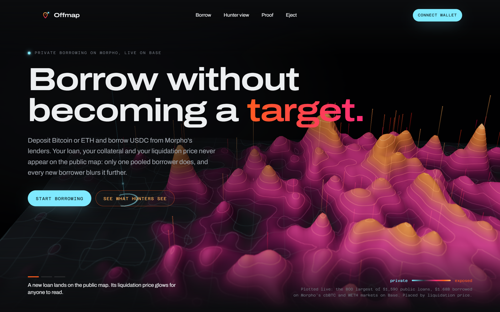
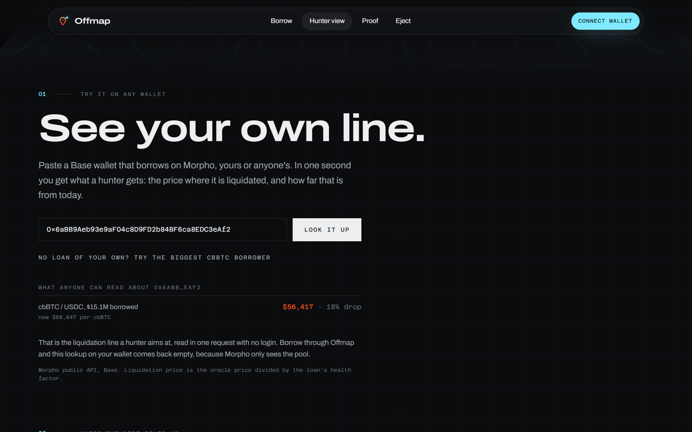
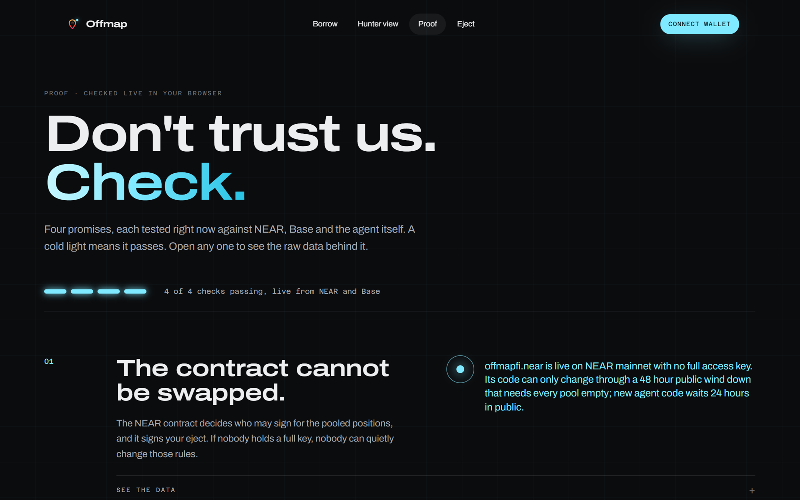
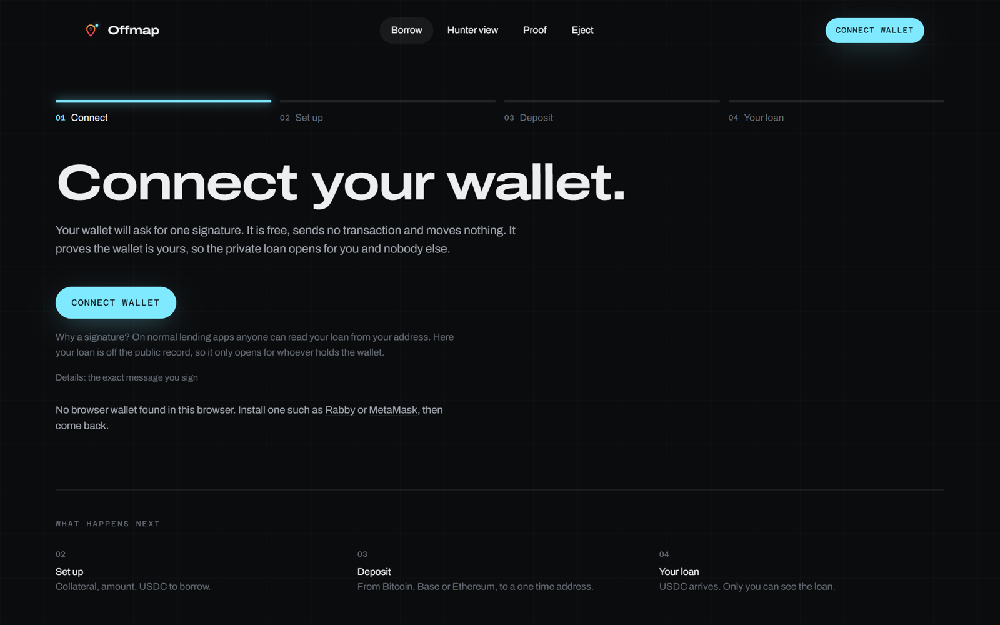
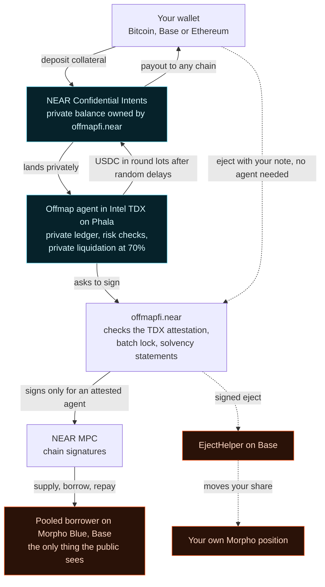

<div align="center">


# Offmap

**Your liquidation price is public. Offmap hides it.**

Borrow USDC against your Bitcoin or ETH on real Morpho liquidity. Nobody can see your loan, your collateral or the price where you get liquidated: the public record shows one pooled borrower, and every new borrower blurs it further.

<p>
  <a href="https://offmap.jdollar.site"></a>
  <a href="https://x.com/Dollar782/status/2121277976817901959"></a>
  <a href="https://nearblocks.io/address/offmapfi.near"></a>
  <a href="https://b85acd75d1ee0d9a37241a18f68a6c55376b5e3a-8787.dstack-pha1-prod5.phala.network/attestation"></a>
  <a href="https://basescan.org/address/0x5bDE486bF9F69331100F48edfF3cf580CB869B5a"></a>
  <a href="#judge-fast-path-five-minutes-no-keys"></a>
  <a href="LICENSE"></a>
</p>

**[offmap.jdollar.site](https://offmap.jdollar.site)** · [Hunter view](https://offmap.jdollar.site/hunter) · [Proof](https://offmap.jdollar.site/proof) · [Demo video](https://x.com/Dollar782/status/2121277976817901959) · Built at NEAR HACKATHON



</div>

<table>
  <tr>
    <td width="33%"></td>
    <td width="33%"></td>
    <td width="33%"></td>
  </tr>
  <tr>
    <td>Paste any wallet. See the line a hunter sees.</td>
    <td>Four promises, checked live in your browser.</td>
    <td>Borrow in four steps. Only you see the loan.</td>
  </tr>
</table>

## The problem

Every loan on a public lending market is a target. Anyone can read your size, your collateral and the exact price where you get liquidated, and traders push price into those levels. Hiding who you are does not help: hunters don't need your name, they need your level.

This already happens. In March 2025, 10x Research [warned](https://forklog.com/en/hyperliquid-opens-the-door-to-a-crowd-led-whale-hunt-says-10x-research/) that Hyperliquid's public positions and liquidation levels let groups of traders coordinate to push price into them. Lending markets publish the same thing. Open the [hunter view](https://offmap.jdollar.site/hunter) to see the liquidation levels of the 500 largest Morpho borrowers, live, right now.

## What Offmap does

You borrow through a few pooled positions on Morpho Blue (Base). The pool is run by an agent inside Intel TDX hardware, so your loan exists only in a private ledger that nobody can read, not us and not the host. The world sees one borrower per pool. You see your own loan.




Cyan is private, orange is public. Dotted lines are the eject path, which works even if the agent is gone.

## Why not just borrow on Morpho?

Morpho is where the money sits. Offmap is the part Morpho can't give you: a loan nobody can see.

| | On Morpho directly | Through Offmap |
|---|---|---|
| Your size, collateral and liquidation price | Public to anyone | Seen only by you. The world sees one pooled borrower per cohort |
| When you get close to liquidation | Anyone can see it coming and liquidate you at a known price | Private liquidation inside the agent at 70% loan to value |
| Getting money in and out | From Base, from a wallet tied to your position | Collateral in from Bitcoin, Base or Ethereum; USDC out and repayments in on NEAR, Ethereum, Base, Arbitrum, Optimism or Solana, all through Confidential Intents, paid in round lots after random delays |
| Liquidity and rates | Morpho | The same Morpho markets |
| Cost | Morpho's borrow rate | Morpho's borrow rate plus 1% a year |
| If the operator disappears | Not applicable | Eject from the contract to your own Morpho position, no agent needed |

## Why only here

Offmap needs three things at once, and NEAR is where they meet: **confidential cross chain settlement** (Confidential Intents) to move money in and out privately, **chain signatures** so a NEAR contract controls the Morpho position on Base with no bridge and no human key, and a contract that **verifies a hardware attestation** before it signs (the Shade Agent pattern).

## Judge fast path (five minutes, no keys)

1. **Run the checks.** Node 22 or newer, nothing to install:
   ```bash
   git clone https://github.com/jenzylove/offmap && cd offmap
   node scripts/judge-checks.mjs
   ```
   You see `10 passed, 0 failed`: the contract requires a TEE, the live agent is registered with a real TDX attestation whose compose hash equals the one approved on chain, only the agent's key can move the confidential balance, each cohort's public Morpho collateral equals the solvency statement, the cohort has authorized the eject helper on Morpho, and the helper is live on Base.
2. **Open the [hunter view](https://offmap.jdollar.site/hunter) and paste any Base wallet.** You get its liquidation price and how far it sits from today, straight from the public Morpho API, in a second. No wallet of your own? Tap "try the biggest cbBTC borrower". Below it, the liquidation levels of the 500 largest public Morpho borrowers sit next to the Offmap cohort. The cohort is one borrower; nothing per user exists anywhere public.
3. **Open the agent's [health](https://b85acd75d1ee0d9a37241a18f68a6c55376b5e3a-8787.dstack-pha1-prod5.phala.network/health) and [attestation](https://b85acd75d1ee0d9a37241a18f68a6c55376b5e3a-8787.dstack-pha1-prod5.phala.network/attestation).** Then rebuild the compose hash from this repo: `cd contracts/near/deploy && node verify-compose.mjs` (needs `npm i -g @neardefi/shade-agent-cli`). It equals `tcb_info.compose_hash` in the attestation.
4. **Borrow yourself.** On [/app](https://offmap.jdollar.site/app), sign in with an EVM wallet, deposit a few dollars of BTC, cbBTC or WBTC (cbBTC pool) or WETH on Base (ETH pool), borrow USDC to any wallet. Your view shows your loan and liquidation price; the hunter view still shows only the cohort.

## What is real

| Part | State | Proof |
|---|---|---|
| `offmapfi.near` contract | Live on NEAR mainnet, requires TEE | [deploy](https://nearblocks.io/txns/28BvAxvTXkr2VhpRq2xZwkkDPJR9jSyjUmCv8vM7P12E), [code](contracts/near) |
| Agent in Intel TDX | Running on Phala (dstack 0.5.12), registered with a real attestation | [register_agent](https://nearblocks.io/txns/B5zGUub7dp15BHHpuR8ZEUQhN3wKyP5iSn9Q2wR9Ssez), `/attestation` |
| Pooled Morpho position | Live on Base, cbBTC/USDC cohort | [`0x5bDE…9B5a`](https://basescan.org/address/0x5bDE486bF9F69331100F48edfF3cf580CB869B5a) |
| Private loan, end to end | Done on mainnet through the TEE agent: 6,296 sats supplied, 1.5 USDC borrowed, paid in two lots | [lot 1](https://basescan.org/tx/0x683d935fe501c4e83179d375645fcc66215458a2da2ee073008b81abb96fc92b), [lot 2](https://basescan.org/tx/0xa7151c2ed4e3bc6ecb1b67c016569bc122503487d0c302f313bc9e03c081a42a), [build log](docs/BUILD_LOG.md) |
| Confidential balance custody | Owned by `offmapfi.near`; only the attested agent key is registered on `intents.near` | `node scripts/judge-checks.mjs` |
| Solvency statements | Posted on chain each batch: totals, reserve, salted Merkle root of every position | contract view `statement` |
| Eject | Live on mainnet: a user left the pool through the contract alone. offmapfi.near verified the leaf and the NEAR MPC signer signed; the helper moved the loan to the user's own Morpho position on Base and the pooled borrower went to zero | NEAR [Bmzf1bgg…](https://nearblocks.io/txns/Bmzf1bggxs4gFidYxmH8wg9ReMCNTYG37q3aZ1oaarNY), Base [0x1c765da1…](https://basescan.org/tx/0x1c765da1410120e8f4054434a7d49b6217bee3fcefc2178855dfbbc3e2569470), helper [`0x262f…f8b8`](https://basescan.org/address/0x262fe96b235be762dca8cc1937a542848e12f8b8) |
| Batch lock | Live: the agent can get a cohort signature only inside a lock, ejects pause while it is open (30 minutes at most) and always reopen for at least 2 minutes after, and the new statement lands before any money moves | [begin_batch](https://nearblocks.io/txns/9YGLmXtBERqVN7vuHRhS5CKaqfJ1hi8ZKWL5aNb9gfWF), [borrow](https://basescan.org/tx/0x9b216922cfd7288b316a7de59a6b35743aa4de27b25a09dcd8476e3f9323aa4c), [end_batch](https://nearblocks.io/txns/Gbrk8A2xLnqX6ke1qNLJGAdd122diW8CnVjFK6LgAaLg) |
| Leak study | Runs hourly on Offmap's own traffic, served at `/public/leak` | [agent](https://b85acd75d1ee0d9a37241a18f68a6c55376b5e3a-8787.dstack-pha1-prod5.phala.network/public/leak) |
| Second cohort (WETH/USDC) | Configured, no loans yet | contract `config` |

## For judges: each track, mapped to the code

| Track | What to look at | Where it is |
|---|---|---|
| **Unstoppable DeFi** | Real loans on Morpho Blue through a pooled borrower. Collateral in from Bitcoin, Base or Ethereum and USDC out through NEAR Intents. Risk rules and private liquidation at 70%. An eject that needs nobody's permission, already run on mainnet | [`apps/agent/src/engine.ts`](apps/agent/src/engine.ts), [`apps/agent/src/intents.ts`](apps/agent/src/intents.ts), [`packages/core/src/risk.ts`](packages/core/src/risk.ts), [`contracts/base/src/EjectHelper.sol`](contracts/base/src/EjectHelper.sol) |
| **Privacy and Private AI** | The ledger lives only inside Intel TDX. The contract checks the attestation before it will sign. Confidential Intents balances for custody and payouts. Salted Merkle notes, so a statement cannot be opened by guessing amounts. A leak study that measures how private it really is | [`contracts/near/src/lib.rs`](contracts/near/src/lib.rs), [`packages/core/src/merkle.ts`](packages/core/src/merkle.ts), [`apps/agent/src/leak.ts`](apps/agent/src/leak.ts), [`apps/web/src/app/proof/ProofSheet.tsx`](apps/web/src/app/proof/ProofSheet.tsx) |

## The business in one number

Offmap charges **1% a year on top of Morpho's borrow rate**. On $10M of private loans that is $100,000 a year, from day one, with no lenders to recruit: Morpho supplies the liquidity.

## How it is built

| Path | What |
|---|---|
| [`packages/core`](packages/core) | Private ledger, risk rules (60% open, private liquidation at 70%), batch netting, loss waterfall, salted Merkle tree, notes. 55 tests including a 10,000 operation property test |
| [`apps/agent`](apps/agent) | The TEE agent: batches, Morpho through chain signatures, confidential Intents in and out, price median of four sources, encrypted state, HTTP API |
| [`contracts/near`](contracts/near) | `offmapfi.near`: Shade Agent registration with TDX attestation, intents key custody, statements, MPC signing gate, eject transaction builder, batch lock, timelocked config, recovery. 69 tests |
| [`contracts/base`](contracts/base) | `EjectHelper`: one transaction eject with a Morpho flash loan |
| [`apps/web`](apps/web) | The site: landing, borrow, your view, hunter view, proof, eject |
| [`docs`](docs) | [PRD](docs/PRD.md), [architecture](docs/ARCHITECTURE.md), [spikes](docs/spikes), [build log](docs/BUILD_LOG.md) |

Run locally: `pnpm install && pnpm -r test` (core, agent, web), `cd contracts/near && cargo test` (contract, 69 tests), `cd contracts/base && forge install foundry-rs/forge-std@v1.17.0 --no-git && forge test --fork-url https://mainnet.base.org` (eject helper on a Base fork).

## Who you trust

| Who | What they could do | What stops them |
|---|---|---|
| Intel TDX | If the sealed chip were broken, whoever runs the machine could read the private ledger | Nothing on our side; this is the one real trust, as with every TEE product. Reading the ledger still does not move money |
| Phala, the host | Switch the machine off; it cannot read inside | Eject: with your downloaded note, the contract alone moves your share to your own Morpho position (done on mainnet) |
| Us, the builders | Propose new agent code | It waits 24 hours in public on `offmapfi.near`, so you can eject first. The contract itself only changes through a 48 hour wind down with every pool empty |
| NEAR MPC network | Signs for the pooled Base positions | It signs only what `offmapfi.near` asks for: an attested agent inside a batch lock, or a valid eject |
| Morpho, NEAR Intents | Hold the loan, move money in and out | Public protocols; every move they make for Offmap is on chain |

The same table is live on the [proof page](https://offmap.jdollar.site/proof#trust), next to the current pool size.

## Scope and limits

- While the agent runs, you trust it and its sealed hardware: it holds the private balance and the contract signs what it asks for. If it stops, eject works through the contract without it.
- Agent updates ship through Phala in place and keep the agent's keys. Each update changes the attested compose hash, which `node scripts/judge-checks.mjs` compares with the hash approved on chain.
- An eject that fails on Base (its nonce taken, fees spiked) needs a newer statement to retry. If the agent has stopped for good, no newer statement comes; the cohort's Base address also needs a little ETH for gas, which anyone can send.
- Privacy grows with volume. With few users per batch the leak study shows real linkage, and says so.
- Owner powers are bounded by the contract: a config change (new agent code) waits 24 hours in public before anyone can apply it, dev mode cannot be switched back on, and winding down needs a 48 hour notice and empty cohorts. The account's key status reads live on the proof page and with `near account list-keys offmapfi.near`.
- Unaudited hackathon build. Loan and cohort caps are enforced in code.

## Built with

NEAR (contracts, chain signatures `v1.signer`, NEAR Intents and Confidential Intents through the 1Click API), Phala Cloud (Intel TDX, dstack), `@neardefi/shade-agent-js` and `shade-attestation`, Morpho Blue on Base, viem, Next.js, Foundry, cargo-near. Code was written with AI assistance (Claude Code), reviewed and tested by the author.

The author's other NEAR HACKATHON project is **KEYFALL** ([github.com/jenzylove/keyfall](https://github.com/jenzylove/keyfall)), a separate and independent memecoin game on NEAR's quantum safe keys.

MIT licensed.
