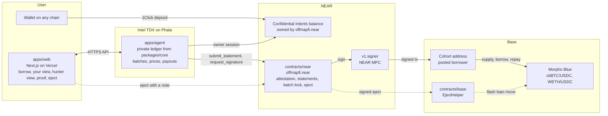

# Offmap architecture

How the four parts fit together, and the interfaces between them.

## Identities and keys

| Thing | Value |
|---|---|
| Contract | `offmapfi.near` (mainnet). Dev: a testnet account |
| MPC | `v1.signer` mainnet, `v1.signer-prod.testnet` testnet; domain 0 secp256k1; deposit 1 yocto |
| Cohort Base address | derived from predecessor `offmapfi.near`, path `cohort:<cohort_id>` (e.g. `cohort:cbbtc-usdc`) |
| Agent NEAR account | 64 hex implicit account generated inside the TEE (ephemeral) |
| Confidential Intents balance owner | `offmapfi.near` itself. `register_agent` adds the attested agent's key to `intents.near` (`add_public_key`); expired or replaced agents are pruned; recovery mode removes all agent keys. Agents sign intents with `signer_id = offmapfi.near` |
| Morpho Blue | `0xBBBBBbbBBb9cC5e90e3b3Af64bdAF62C37EEFFCb` on Base (8453) |
| Cohort `cbbtc-usdc` | market `0x9103c3b4e834476c9a62ea009ba2c884ee42e94e6e314a26f04d312434191836`, collateral cbBTC `0xcbB7C0000aB88B473b1f5aFd9ef808440eed33Bf` (8 dec) |
| Cohort `weth-usdc` | market `0x8793cf302b8ffd655ab97bd1c695dbd967807e8367a65cb2f4edaf1380ba1bda`, collateral WETH `0x4200000000000000000000000000000000000006` (18 dec) |
| EjectHelper (Base mainnet) | `0x262fe96b235be762dca8cc1937a542848e12f8b8`, deployed by the MPC controlled address `0xf0Ad…6004` in [0x0a60bd…](https://basescan.org/tx/0x0a60bd60acdda6bef6b7f56066b7fa28bc4f04b21e8cce5ece71dfd7111074f1), source verified on Sourcify |
| Loan token | USDC on Base `0x833589fCD6eDb6E08f4c7C32D4f71b54bdA02913` (6 dec) |

## Merkle leaf (identical in TypeScript and Rust)

`leaf = keccak256(keccak256(cohortId utf8) || keccak256(userId utf8) || u256be collateral || u256be debt || u256be nonce || salt[32])`, positional hashing `keccak256(left || right)`, tree padded to max(1024, next pow2) with `keccak256("offmap-pad" || u32be index)`. Source of truth: `packages/core/src/merkle.ts`.

`userId` = lowercase hex of `keccak256(owner auth string)`, where the owner auth string is `evm:<lowercase address>` or `near:<account id>`. The user's eject destination is the EVM address in their note.

## Contract `offmapfi.near` (contracts/near)

State: config (changed only through propose_config, then apply_config by anyone after a 24 hour public notice), agent registry, batch locks (raw storage under `x:`), agent registry, per cohort latest `Statement`, eject queue, recovery timer.

| Method | Who | Does |
|---|---|---|
| `new(config)` | deploy | config: mpc contract id, cohorts (id, market id, collateral token, base chain id, eject helper address, size cap, ceiling bps), approved TEE measurements, attestation expiry, statement max age, recovery delay |
| `register_agent(attestation)` | anyone | Shade Agent pattern: verify TDX attestation (or local whitelist in dev builds only), report data = agent account id; stores agent + expiry |
| `submit_statement(stmt)` | registered agent | stmt: cohort_id, batch_id (strictly increasing), total_collateral, total_debt, reserve, merkle_root, leaf_count, timestamp_ms. Rejects if ltv(total) > ceiling or debt > size cap |
| `request_signature(cohort_id, payload_hex)` | registered agent | requires a statement for that cohort newer than max age; calls `v1.signer.sign` with path `cohort:<id>`; returns the MPC signature |
| `eject(cohort_id, leaf, proof, eject_args)` | anyone | verifies leaf against the latest root; enqueues; builds the EIP-1559 tx calling `EjectHelper.eject(...)` from the cohort address, with nonce/gas supplied by the caller (bounded), and requests the MPC signature; marks the leaf ejected so it cannot repeat |
| `recover()` | anyone | if no statement for `recovery_delay`, flips to recovery mode: request_signature closed, only eject open |
| views | anyone | `config`, `agent`, `statement(cohort)`, `cohort_address_path(cohort)`, `ejects(cohort)`, `mode` |

No owner, no upgrade: full access keys deleted after deploy. Reproducible build (NEP-330).

## Agent HTTP API (apps/agent) used by apps/web

All JSON. User auth: the user signs `offmap:auth:<nonce>:<deadline>` with their wallet (EIP-191 for EVM, NEP-413 for NEAR); `POST /auth` returns a session token.

| Route | Does |
|---|---|
| `GET /health` | agent account, attestation status, cohorts, last batch |
| `POST /auth` | wallet signature → session |
| `POST /quote/borrow` | {cohort, depositAsset (1Click asset id), depositAmount, borrowUsdc, receiveAsset, receiveChain, receiveAddress} → risk check + 1Click deposit address (recipient: agent confidential balance) |
| `GET /position` | session → own collateral, debt, health, liquidation price, latest note (with salt and proof) |
| `POST /repay/quote` | session → 1Click deposit address to repay from any chain |
| `POST /withdraw` | session → withdraw collateral or pay out borrowed USDC (round lots, delay choice) |
| `GET /public/cohorts` | cohort addresses, live Morpho positions, latest statements (what the hunter sees) |
| `GET /public/leak` | latest leak study and level attack results |

## Web routes (apps/web)

`/` landing (numbered sections, FAQ, footer), `/app` borrow, `/app/position` your view, `/hunter` hunter view, `/proof`, `/eject`. All public numbers read live from chain or the agent; when unreachable, the page says so.
